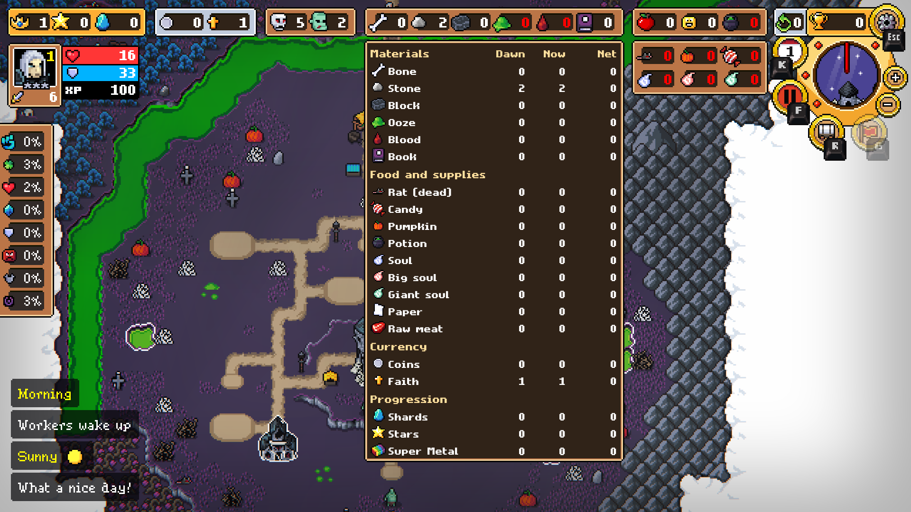

# Daybook

Daybook adds a daily resource ledger to Super Fantasy Kingdom. A strip beneath the material icons shows how much of each resource you have gained or spent since dawn. Hold **Alt** to compare dawn, current, and net balances for materials, food, currency, and progression resources. The ledger follows the active kingdom’s icons and UI scale.


## Install

On the [Daybook Thunderstore listing](https://thunderstore.io/c/super-fantasy-kingdom/p/GKJ/Daybook/), choose **Install with App**, select your Super Fantasy Kingdom profile, and choose **Start modded**. To hide the panel, set `ShowOverlay = false` in the profile’s `BepInEx/config/sfk.daybook.cfg`.

If you enter a run mid-day, **Now** shows your inventory immediately. **Dawn** and **Net** fill in at the next dawn.



[View all four gameplay screenshots](docs/screenshots)

## Project layout

| Location | Contents |
| --- | --- |
| [src/Daybook](src/Daybook) | Plugin lifecycle, resource tracking, and in-game HUD |
| [thunderstore](thunderstore) | Package manifest, icon, and public listing text |
| [docs/screenshots](docs/screenshots) | Gameplay images used by GitHub and Thunderstore |
| [CHANGELOG.md](CHANGELOG.md) | Release notes included in the package |

## Build on Windows

Install the .NET SDK, the Windows game, and BepInEx 5 in a mod manager profile. The project targets .NET Standard 2.1 and references the assemblies in your installed game and profile. Set the two paths below for your machine.

```powershell
$gameDir = 'D:\SteamLibrary\steamapps\common\Super Fantasy Kingdom'
$profileDir = Join-Path $env:APPDATA 'Thunderstore Mod Manager\DataFolder\SuperFantasyKingdom\profiles\Daybook Dev'
dotnet build Daybook.csproj -c Release "-p:GameDir=$gameDir" "-p:ProfileDir=$profileDir"
```

The compiled plugin is in `bin/Release/netstandard2.1/Daybook.dll`. To install it into your development profile, close the game and add `-p:DeployMod=true` to the build command.

## Package for Thunderstore

After a successful Release build, run `python package.py` with Python 3 from the repository root. The ZIP in `dist/` contains the plugin, manifest, icon, changelog, and the [Thunderstore listing](thunderstore/README.md).

## Gameplay checks

In a kingdom, compare the compact strip with the Alt ledger after gaining or spending a resource. Check that the comparison resets at dawn, the panel follows the game’s UI scale, and the ledger reflects the active kingdom after switching between Human and Undead.

The 0.3.0 HUD was checked in both kingdoms on Windows with game version 0.8.067 and BepInEx 5.4.23.5. The Undead ledger was checked at 1920 × 1080 with UI scales 1 and 1.5.
