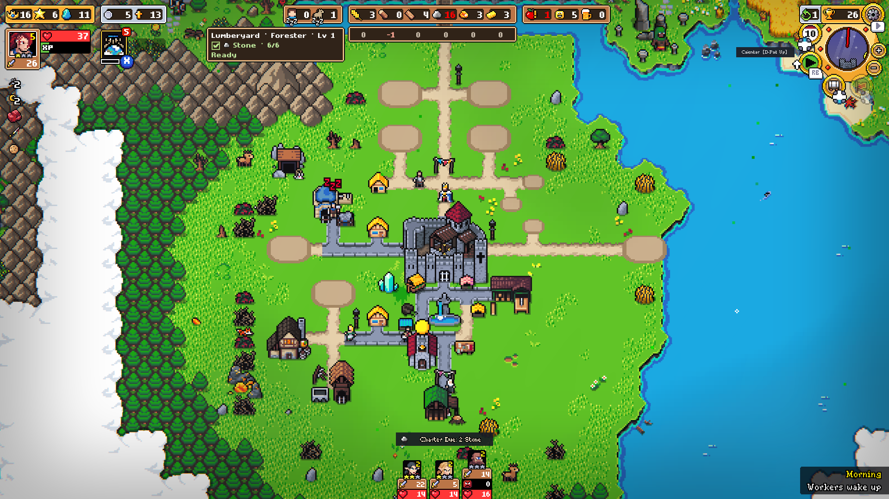
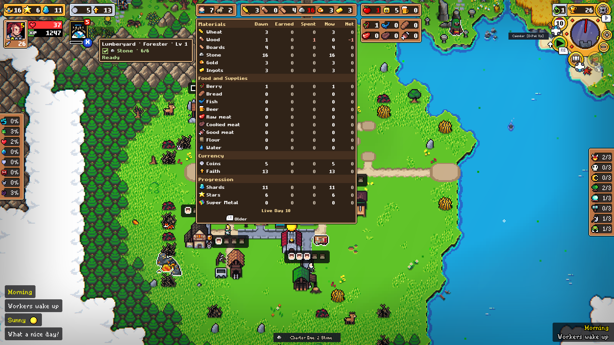
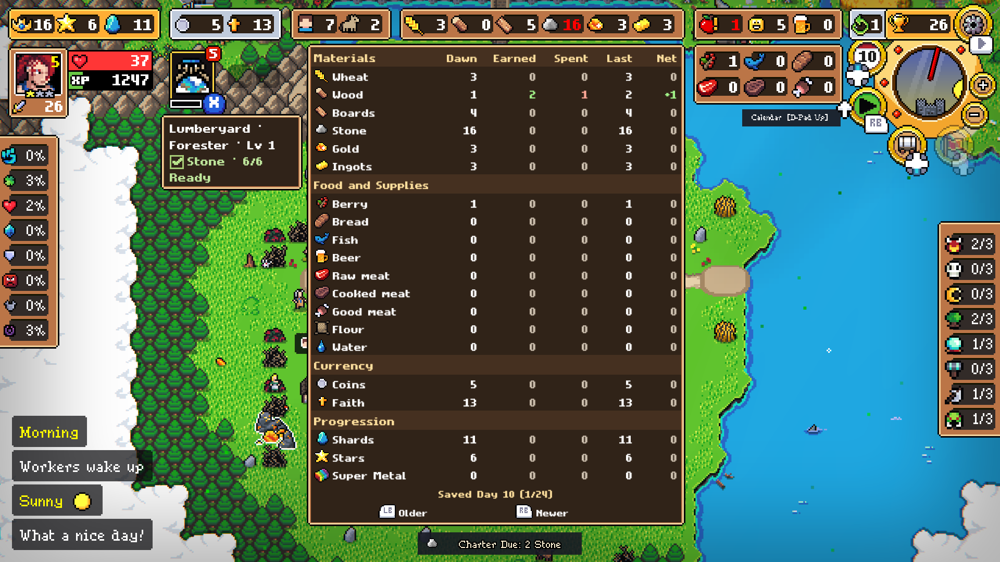

# Daybook

Daybook shows what your kingdom earned, what it spent, and how much is left each day. Check six materials at a glance beneath the resource bar, or open the ledger to compare today's supplies with earlier days in the same run.

## Features

- **Separate gains and spending.** If you gain 8 boards and spend 8 on buildings, the ledger shows 8 earned, 8 spent, and 0 net. You can see the activity even when your stock ends where it started.
- **Follow your kingdom's resources.** The full ledger covers materials, food and supplies, currency, and progression. Human kingdoms can track wood and bread, while Undead kingdoms can track bones and souls.
- **Keep a daily history.** Daybook saves records locally for each profile, kingdom, and run. Continue restores the ledger for a matching checkpoint. If you replay a dawn, the earlier attempt stays available to browse.

## How to Use

1. After the first dawn Daybook observes, look beneath each material icon for its net change since dawn.
2. Hold **Alt** on keyboard, **RT** on Xbox, or **R2** on PlayStation to open the ledger. Read across a row to compare **Dawn**, **Earned**, **Spent**, **Now**, and **Net**. On a saved day, **Last** shows the stock at the last observation for that record. An asterisk marks a resource observed for only part of the day.
3. Keep holding the detail key or trigger. Press **Page Up** (keyboard), **LB** (Xbox), or **L1** (PlayStation) for an older record. Press **Page Down**, **RB**, or **R1** to move toward today. The footer shows which directions are available and follows your controller bindings.
4. Release **Alt**, **RT**, or **R2** to return directly to the live strip. Today's totals keep updating while you browse.

## Screenshots



*Read down from each material icon to see its net change since dawn.*



*Wood started at 1. After spending it, Now reads 0 and Net reads −1.*



*On this saved page, wood shows 2 earned and 1 spent. Last reads 2 and Net reads +1. The footer shows both paging directions.*

Captured in Daybook 0.4.2 on Super Fantasy Kingdom 0.8.068 at 1920 × 1080 with a virtual Xbox-style controller.

## Compatibility

- The ledger follows both Human and Undead resource bars at UI scales 1× and 1.5×.
- On Windows game build 0.8.068, the strip and ledger cleared the [Pin a Build Cost](https://thunderstore.io/c/super-fantasy-kingdom/p/GKJ/PinABuildCost/) upgrade, [Kingdom Charters](https://thunderstore.io/c/super-fantasy-kingdom/p/GKJ/KingdomCharters/) debt badge, and [Visitor Calendar](https://thunderstore.io/c/super-fantasy-kingdom/p/GKJ/VisitorCalendar/) prompt at both scales with [Production Bottlenecks](https://thunderstore.io/c/super-fantasy-kingdom/p/GKJ/ProductionBottlenecks/) enabled.
- With ILM's [CheatMenu](https://thunderstore.io/c/super-fantasy-kingdom/p/ILM/CheatMenu/) 1.0.3 set to triple coin rewards, Daybook counted a 5-coin reward as 15 earned and a subsequent 2-coin purchase as 2 spent.
- If you use ownlyme's [Tavern Food Priorities](https://thunderstore.io/c/super-fantasy-kingdom/p/ownlyme/TavernFoodPriorities/), the food rows show kingdom stock. Meals eaten from the tavern's private stores are outside those totals.
- If a mod silently adds and removes stock between observations, the **Earned** and **Spent** columns can miss those changes.

## Installation

1. Choose **Install with App** and select your Super Fantasy Kingdom profile in Thunderstore Mod Manager or r2modman.
2. Install Daybook with its listed dependencies, [BepInExPack](https://thunderstore.io/c/super-fantasy-kingdom/p/BepInEx/BepInExPack/) and [HideManagerGameObject_Config](https://thunderstore.io/c/super-fantasy-kingdom/p/BepInEx/HideManagerGameObject_Config/).
3. Choose **Start modded** and enter your kingdom. To keep recording with the HUD hidden, set `ShowOverlay = false` in your profile's `BepInEx/config/sfk.daybook.cfg`.

## Back Up a Journal

Daybook keeps its journal under `%USERPROFILE%\AppData\LocalLow\Super Fantasy Games\Super Fantasy Kingdom\Daybook`, grouped by game profile, kingdom and run ID. Copy this folder along with your game saves when moving PCs. Daybook writes changed records every two seconds and flushes pending changes on a normal exit.

A matching checkpoint, day and resource balance can restore the live record on Continue. After a forced close, recovery uses the last successful write. Saved pages retain rows for resources that later become unavailable.

## Project layout

| Location | Contents |
| --- | --- |
| [src/Daybook](src/Daybook) | Plugin lifecycle, resource tracking, and in-game HUD |
| [thunderstore](thunderstore) | Package manifest, icon, and public listing text |
| [docs/screenshots](docs/screenshots) | Gameplay images used by GitHub and Thunderstore |
| [CHANGELOG.md](CHANGELOG.md) | Release notes included in the package |

## Build on Windows

Install the .NET SDK, the Windows game, and BepInEx 5 in a mod manager profile. The project targets .NET Standard 2.1 and references the assemblies in your installed game and profile. Set the two paths below for your machine.

```powershell
$gameDir = 'D:\SteamLibrary\steamapps\common\Super Fantasy Kingdom'
$profileDir = Join-Path $env:APPDATA 'Thunderstore Mod Manager\DataFolder\SuperFantasyKingdom\profiles\Daybook Dev'
dotnet build Daybook.csproj -c Release "-p:GameDir=$gameDir" "-p:ProfileDir=$profileDir"
```

The compiled plugin is in `bin/Release/netstandard2.1/Daybook.dll`. To install it into your development profile, close the game and add `-p:DeployMod=true` to the build command.

## Package for Thunderstore

After a successful Release build, run `python package.py` with Python 3 from the repository root. The ZIP in `dist/` contains the plugin, manifest, icon, changelog, and the [Thunderstore listing](thunderstore/README.md).

## Gameplay checks

On Windows, run `python tests/NativeStockChecks/run.py` after packaging to exercise the ZIP's stock hooks in the game's embedded Mono runtime. Pass `--cheat-menu <DLL path>` to check compatibility with the 3× coin reward in ILM/CheatMenu 1.0.3. Both checks run offline.

In a kingdom, compare the compact strip with the Alt ledger after gaining or spending a resource. Check that the comparison resets at dawn, the panel follows the game’s UI scale, and the ledger reflects the active kingdom after switching between Human and Undead.

Run `dotnet run --project tests/JournalChecks -c Release` for the standalone journal checks. For the in-game restart check, earn and spend one material, note the five columns, exit normally, and use Continue. Check the live ledger for the resumed day and use Alt + Page Up to find the earlier record. Repeat at both UI scales.

The 0.3.0 HUD was checked in both kingdoms on Windows with game version 0.8.067 and BepInEx 5.4.23.5. The Undead ledger was checked at 1920 × 1080 with UI scales 1 and 1.5.

## Contributing and license

Bug reports and pull requests are welcome. See the [contribution guide](CONTRIBUTING.md) for local testing and reporting instructions.

The original mod code is available under the [MIT License](LICENSE). Super Fantasy Kingdom, its game assets, and third-party dependencies retain their respective licenses and ownership.

## Support

[Support GKJ Games on Ko-fi](https://ko-fi.com/gkj_games)
