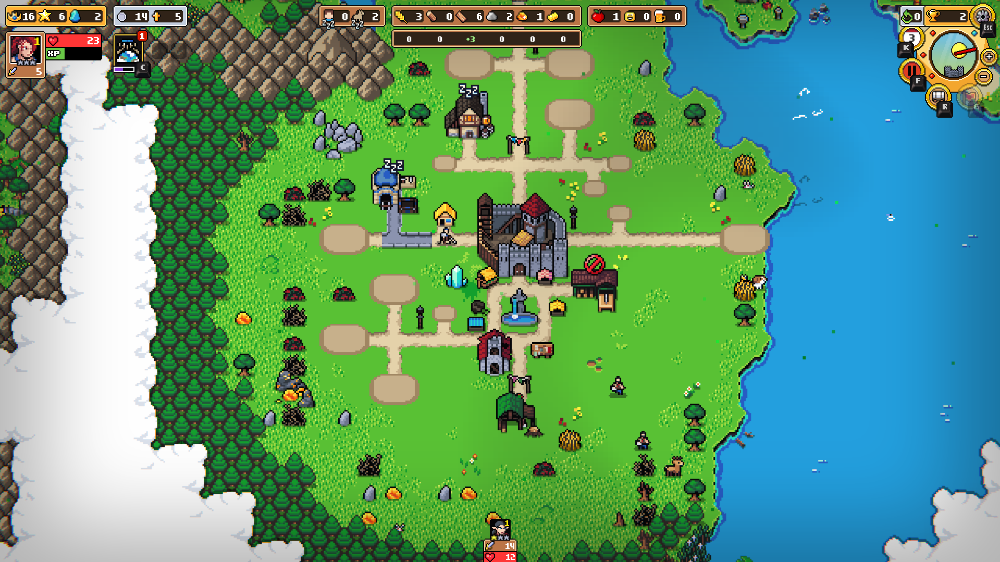
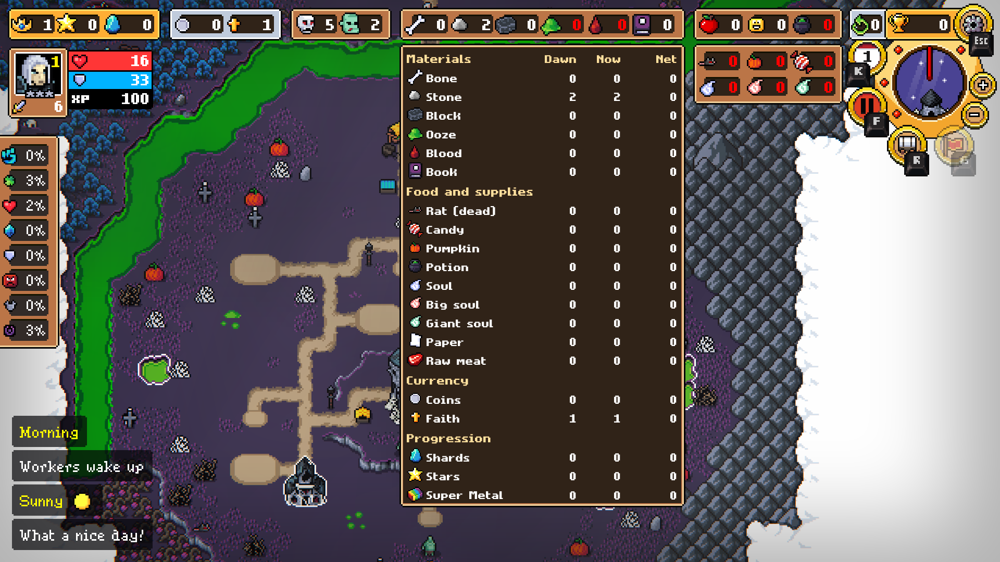

Daybook adds a daily balance beneath your kingdom’s resource bar. If you started the day with 3 boards and have 1 left, a red **−2** appears directly under the boards icon. You can see what you’ve gained or spent while keeping the map in view.

## Hold Alt to open the ledger

The compact strip follows the same order as the material icons above it. Green numbers show a gain, red numbers show a loss, and zero means your stock is back at its dawn balance.

Hold **Alt** to see the full ledger. **Dawn** is the amount you had that morning, **Now** is what you have on hand, and **Net** is the difference. Release Alt to return to the compact strip.

| Resource group | What you can check |
| --- | --- |
| Materials | Wheat, wood, boards, stone, gold, and ingots in the Human Kingdom. Bone, stone, block, ooze, blood, and book in the Undead Kingdom. |
| Food and supplies | Individual stocks such as berries, bread, fish, beer, flour, and water, or kingdom-specific supplies such as candy, potions, souls, and paper. |
| Currency | Coins and faith. |
| Progression | Shards, stars, and super metal. |

Daybook uses the active kingdom’s names and icons. If you load a run mid-day, **Now** shows your stock immediately. **Dawn** and **Net** show a dash until the next dawn, when the new day’s comparison begins.

## Install and play

Choose **Install with App** on this page, select your Super Fantasy Kingdom profile, and launch with **Start modded**. The strip appears beneath the material icons when you enter a kingdom.

To hide Daybook, set `ShowOverlay = false` in your profile’s `BepInEx/config/sfk.daybook.cfg`.

Tested on Windows with **Super Fantasy Kingdom 0.8.067** and **BepInEx 5.4.23.5** in both Human and Undead kingdoms. The expanded Undead ledger was checked at **1920 × 1080** with UI scales **1** and **1.5**.
