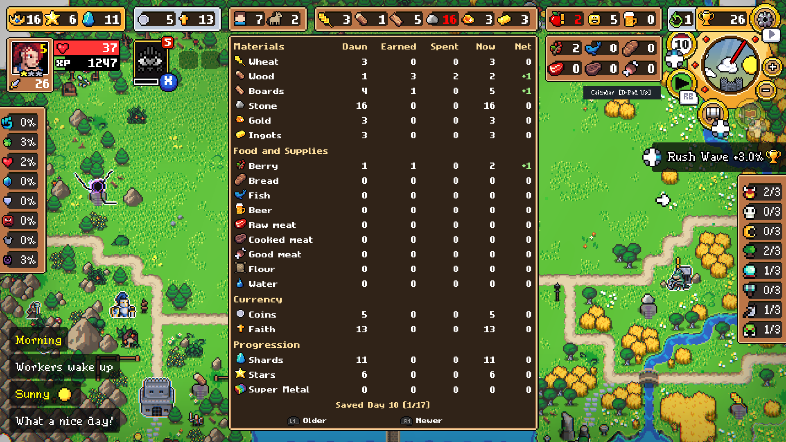

# Daybook

Daybook shows what your kingdom earned, what it spent, and how much is left each day. Check six materials at a glance beneath the resource bar, or open the ledger to compare today's supplies with earlier days in the same run.

## Features

- **Separate gains and spending.** If you gain 8 boards and spend 8 on buildings, the ledger shows 8 earned, 8 spent, and 0 net. You can see the activity even when your stock ends where it started.
- **Follow your kingdom's resources.** The full ledger covers materials, food and supplies, currency, and progression. Human kingdoms can track wood and bread, while Undead kingdoms can track bones and souls.
- **Keep a daily history.** Daybook saves records locally for each profile, kingdom, and run. Continue restores the ledger for a matching checkpoint. If you replay a dawn, the earlier attempt stays available to browse.

## How to Use

1. After the first dawn Daybook observes, look beneath each material icon for its net change since dawn.
2. Hold **Alt** on keyboard, **RT** on Xbox, or **R2** on PlayStation to open the ledger. Read across a row to compare **Dawn**, **Earned**, **Spent**, **Now**, and **Net**. An asterisk marks a resource observed for only part of the day.
3. Keep holding the detail key or trigger. Press **Page Up** (keyboard), **LB** (Xbox), or **L1** (PlayStation) for an older record. Press **Page Down**, **RB**, or **R1** to move toward today. The footer shows which directions are available and follows your controller bindings.
4. Release **Alt**, **RT**, or **R2** to return directly to the live strip. Today's totals keep updating while you browse.

## Screenshots

*At 1× UI scale, read straight down from a material icon to see its change since dawn.*

*The wood row shows 3 earned and 2 spent, leaving a net gain of 1. The footer shows which keys browse history.*

*At 1.5×, look below the saved day for the older and newer shoulder buttons. All three images are from Daybook 0.4.1 in-game. The PlayStation capture used simulated controller input.*

## Compatibility

- The ledger follows both Human and Undead resource bars at UI scales 1× and 1.5×.
- The HUD and journal controls were tested in-game alongside GKJ's [Pin a Build Cost](https://thunderstore.io/c/super-fantasy-kingdom/p/GKJ/PinABuildCost/) 0.1.0 and [Production Bottlenecks](https://thunderstore.io/c/super-fantasy-kingdom/p/GKJ/ProductionBottlenecks/) 0.1.3.
- With ILM's [CheatMenu](https://thunderstore.io/c/super-fantasy-kingdom/p/ILM/CheatMenu/) 1.0.3 set to triple coin rewards, Daybook counted a 5-coin reward as 15 earned and a subsequent 2-coin purchase as 2 spent.
- If you use ownlyme's [Tavern Food Priorities](https://thunderstore.io/c/super-fantasy-kingdom/p/ownlyme/TavernFoodPriorities/), the food rows show kingdom stock. Meals eaten from the tavern's private stores are outside those totals.
- If a mod silently adds and removes stock between observations, the **Earned** and **Spent** columns can miss those changes.

## Installation

1. Choose **Install with App** and select your Super Fantasy Kingdom profile in Thunderstore Mod Manager or r2modman.
2. Install Daybook with its listed dependencies, [BepInExPack](https://thunderstore.io/c/super-fantasy-kingdom/p/BepInEx/BepInExPack/) and [HideManagerGameObject_Config](https://thunderstore.io/c/super-fantasy-kingdom/p/BepInEx/HideManagerGameObject_Config/).
3. Choose **Start modded** and enter your kingdom. To keep recording with the HUD hidden, set `ShowOverlay = false` in your profile's `BepInEx/config/sfk.daybook.cfg`.
