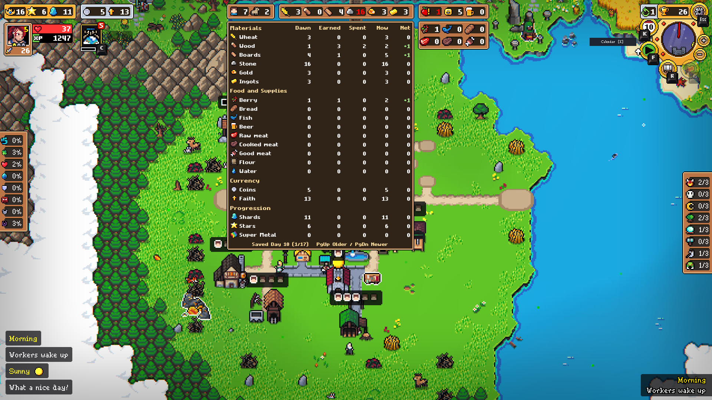

Daybook shows what your kingdom earned, what it spent, and how much is left each day. Check six materials at a glance beneath the resource bar, or open the ledger to compare today's supplies with earlier days in the same run.

## Features

- **Separate gains and spending.** If you gain 8 boards and spend 8 on buildings, the ledger shows 8 earned, 8 spent, and 0 net. You can see the activity even when your stock ends where it started.
- **Follow your kingdom's resources.** The full ledger covers materials, food and supplies, currency, and progression. Human kingdoms can track wood and bread, while Undead kingdoms can track bones and souls.
- **Keep a daily history.** Daybook saves records locally for each profile, kingdom, and run. Continue restores the ledger for a matching checkpoint. If you replay a dawn, the earlier attempt stays available to browse.

## How to Use

After Daybook sees its first dawn, read the number beneath each material icon for its net change. Open the ledger to compare **Dawn**, **Earned**, **Spent**, **Now**, and **Net**. An asterisk marks a resource Daybook observed for only part of the day.

| Action | Keyboard | Xbox | PlayStation |
| --- | --- | --- | --- |
| Open the ledger | Hold Alt | Hold RT | Hold R2 |
| Page to an older record | Alt + Page Up | RT + LB | R2 + L1 |
| Page toward the current day | Alt + Page Down | RT + RB | R2 + R1 |
| Return to the live strip | Release Alt | Release RT | Release R2 |

These are the default controls. The ledger shows the paging directions available from the selected day and follows your in-game controller bindings. Today's totals keep updating while you browse.

## Screenshots

*At 1× UI scale, read straight down from a material icon to see its change since dawn.*

*The wood row shows 3 earned and 2 spent, leaving a net gain of 1. The footer shows which keys browse history.*

*At 1.5×, look below the saved day for the older and newer shoulder buttons. All three images are from Daybook 0.4.1 in-game. The PlayStation capture used simulated controller input.*

## Compatibility

Daybook supports the Human and Undead resource bars and both in-game UI scales. It was tested alongside Pin a Build Cost and Production Bottlenecks. Mods that change stock silently between observations can hide offsetting gains and spending from the daily totals.

## Installation

1. Choose **Install with App** and select your Super Fantasy Kingdom profile in Thunderstore Mod Manager or r2modman.
2. Install Daybook with its listed dependencies, **BepInExPack** and **HideManagerGameObject_Config**.
3. Choose **Start modded** and enter your kingdom. To keep recording with the HUD hidden, set `ShowOverlay = false` in your profile's `BepInEx/config/sfk.daybook.cfg`.
