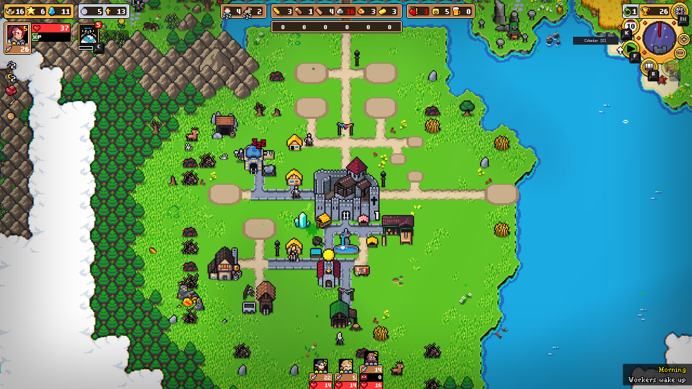

Daybook tracks what your kingdom earns and spends each day in **Super Fantasy Kingdom**. A compact strip beneath the material icons shows how much each stock has risen or fallen since dawn. Open the detailed ledger to see what came in, what went out, and what you have left.

## What Daybook tracks

- **Materials** follow your kingdom. Humans track wheat, wood, boards, stone, gold, and ingots. Undead track bone, stone, block, ooze, blood, and book.
- **Food and supplies** are tracked individually, from berries, bread, and beer to kingdom-specific supplies such as souls and potions.
- **Currency and progression** include coins, faith, shards, stars, and super metal.

For each resource, the ledger lists **Dawn**, **Earned**, **Spent**, **Now**, and **Net**. A reported gain of 8 boards followed by a reported spend of 8 shows **8 earned**, **8 spent**, and **0 net**. Daybook also observes direct changes through the game's coin, shard, star, super metal, and faith setters. If a mod writes stock silently through another path, offsetting changes between samples can go unseen.

An asterisk marks a resource first seen after dawn or tracked through a gap. **Earned** and **Spent** show the changes Daybook observed. **Dawn** and **Net** appear when dawn stock is known. Net includes any stock change across a gap.

## Daily history

Daybook saves your ledger locally as you play. Browse earlier days from the same run while your current day keeps updating. Saved pages keep their resource rows even when a resource becomes unavailable. When you continue from a matching game checkpoint, Daybook restores the corresponding balances. If the game takes you back to an earlier dawn, your previous attempt stays in history and the replay gets its own record.

## Controls

| Action | Keyboard | Xbox | PlayStation |
| --- | --- | --- | --- |
| Open the ledger | Hold Alt | Hold RT | Hold R2 |
| View an older record | Alt + Page Up | RT + LB | R2 + L1 |
| View a newer record | Alt + Page Down | RT + RB | R2 + R1 |
| Return to the live HUD | Release Alt | Release RT | Release R2 |

These are the default bindings. Daybook follows the game's UI scale and uses the active controller's button icons for history navigation when available.

## Installation

Choose **Install with App**, select your Super Fantasy Kingdom profile, and launch with **Start modded**. To hide the HUD while continuing to record, set `ShowOverlay = false` in `BepInEx/config/sfk.daybook.cfg` in that profile.

## Screenshots

