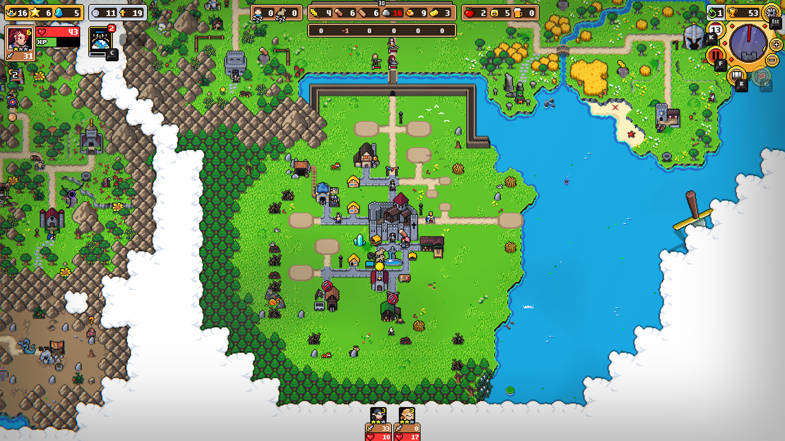
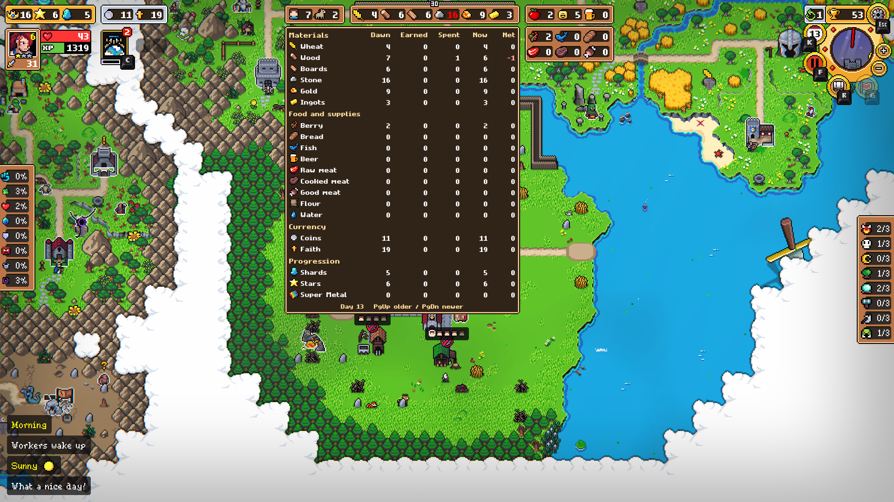
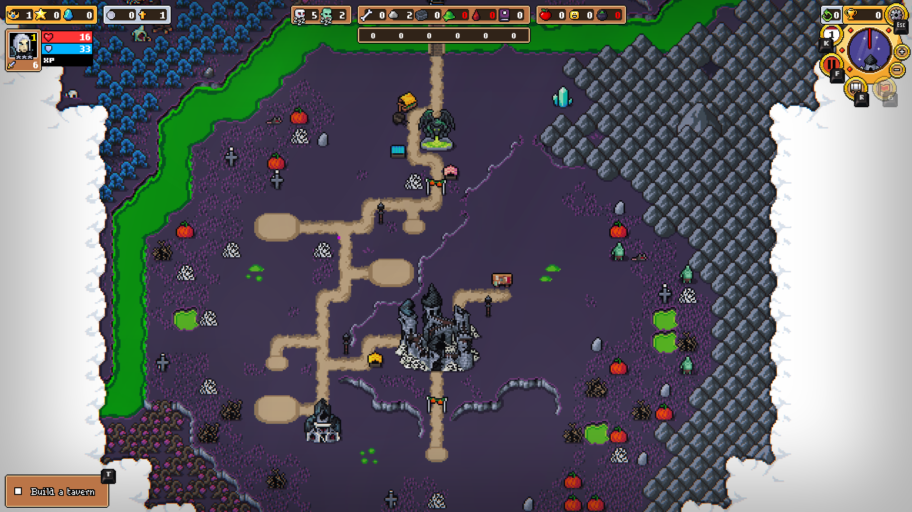
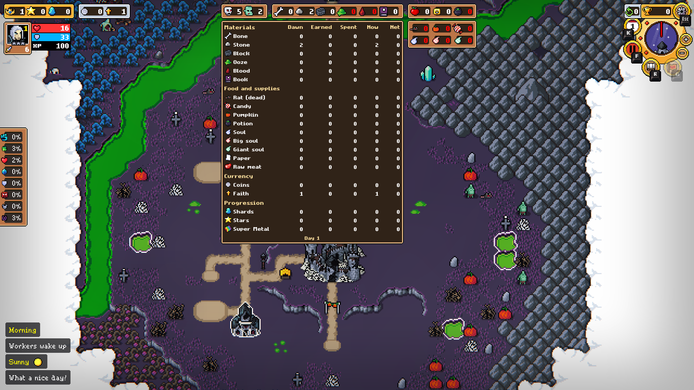

Daybook adds a daily balance beneath your kingdom’s resource bar. In the Human Kingdom screenshot below, the red **−1** under wood means the kingdom has one less wood than it had at dawn. You can see what you’ve gained or spent while keeping the map in view.

## Read the daily ledger

The compact strip follows the same order as the material icons above it. Green numbers show a gain, red numbers show a loss, and zero means your stock is back at its dawn balance.

Hold **Alt** to see the full ledger. **Dawn** is the amount you had that morning, **Earned** and **Spent** count increases and decreases Daybook observes in available stock, **Now** is what you have on hand, and **Net** is the difference from dawn. Earning 8 boards and spending all 8 shows 8 earned, 8 spent, and 0 net. Release Alt to return to the compact strip.

On day 13, the wood row shows 7 at dawn, 0 earned, 1 spent, and 6 on hand. The net change of **−1** matches the compact strip.

| Resource group | What you can check |
| --- | --- |
| Materials | Wheat, wood, boards, stone, gold, and ingots in the Human Kingdom. Bone, stone, block, ooze, blood, and book in the Undead Kingdom. |
| Food and supplies | Individual stocks such as berries, bread, fish, beer, flour, and water, or kingdom-specific supplies such as candy, potions, souls, and paper. |
| Currency | Coins and faith. |
| Progression | Shards, stars, and super metal. |

## Undead Kingdom

The compact strip follows the Undead material bar. Open the ledger to see supplies such as souls, potions, and paper.

## Controller controls

| Action | Xbox | PlayStation |
| --- | --- | --- |
| Open the detailed ledger | Hold RT | Hold R2 |
| Browse older / newer records | While holding RT, press LB / RB | While holding R2, press L1 / R1 |
| Return to the live resource strip | Release RT | Release R2 |

These are the default controls. Daybook follows your in-game detail, pause, and speed bindings and uses the game's button icons when available. The shoulder buttons page only while browsing a ledger with saved records. Keyboard players can hold **Alt** and use **Page Up** or **Page Down**.

## Continue a saved kingdom

Hold **Alt** and press **Page Up** to browse earlier records from the same run. **Page Down** moves toward today. Release Alt to return to the live resource strip.

Daybook saves locally as you play, including when the overlay is hidden. Continuing from a matching checkpoint restores that day's balances. If the game restarts at an earlier dawn, you can read your previous attempt in history while the live ledger tracks the replay. Earlier versions have no saved history to import.

## Install and play

Choose **Install with App** on this page, select your Super Fantasy Kingdom profile, and launch with **Start modded**. The strip appears beneath the material icons when you enter a kingdom.

To hide Daybook, set `ShowOverlay = false` in your profile’s `BepInEx/config/sfk.daybook.cfg`.
