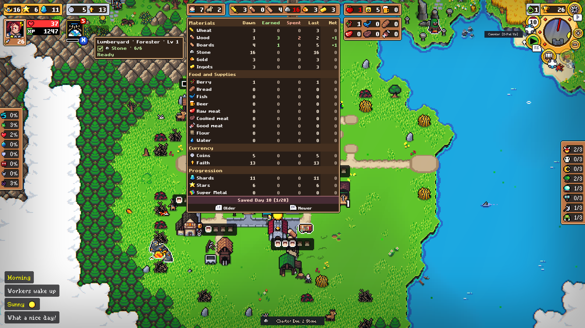
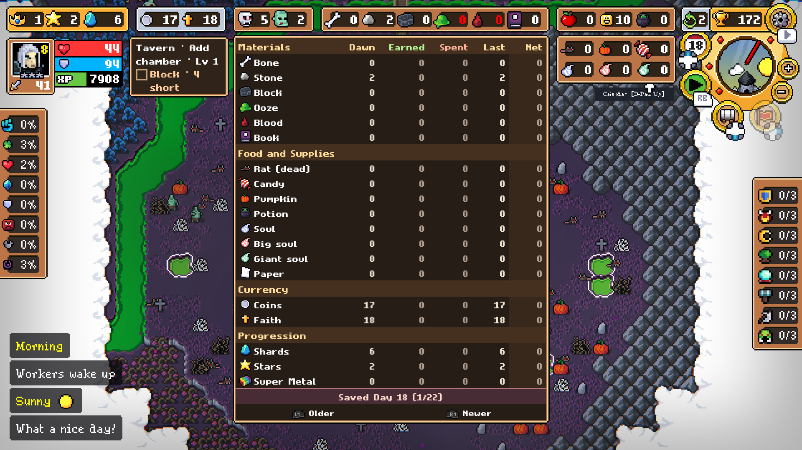

# Daybook

Daybook shows what your kingdom earned, what it spent, and how much is left each day. Check six materials at a glance beneath the resource bar, or open the ledger to compare today's supplies with earlier days in the same run.

## Features

- **Separate gains and spending.** If you gain 8 boards and spend 8 on buildings, the ledger shows 8 earned, 8 spent, and 0 net. You can see the activity even when your stock ends where it started.
- **Follow your kingdom's resources.** The full ledger covers materials, food and supplies, currency, and progression. Human kingdoms can track wood and bread, while Undead kingdoms can track bones and souls.
- **Keep a daily history.** Daybook keeps a separate ledger for each profile, kingdom, and run. When you Continue from a saved night, the ledger shows the balances from that checkpoint after you leave the tavern.

## How to Use

1. After the first dawn Daybook observes, look beneath each material icon for its net change since dawn.
2. Hold **Alt** on keyboard, **RT** on Xbox, or **R2** on PlayStation to open the ledger. Read across a row to compare **Dawn**, **Earned**, **Spent**, **Now**, and **Net**. On a saved day, **Last** shows the stock at the last observation for that record. An asterisk marks a resource observed for only part of the day.
3. Keep holding the detail key or trigger. Press **Page Up** (keyboard), **LB** (Xbox), or **L1** (PlayStation) for an older record. Press **Page Down**, **RB**, or **R1** to move toward today. The footer shows which directions are available and follows your controller bindings.
4. Release **Alt**, **RT**, or **R2** to return directly to the live strip. Today's totals keep updating while you browse.

## Screenshots

*The Human ledger shows three wood earned, two spent, and a net gain of one.*

*The Undead ledger uses its own resource list. L1 and R1 page through saved days while the ledger is open.*

## Compatibility

- Works with Super Fantasy Kingdom **0.8.070** and the other [GKJ mods](https://thunderstore.io/c/super-fantasy-kingdom/p/GKJ/).
- The ledger follows Human and Undead resources at 1× and 1.5× UI scale.
- The HUD shares space with [Pin a Build Cost](https://thunderstore.io/c/super-fantasy-kingdom/p/GKJ/PinABuildCost/), [Production Bottlenecks](https://thunderstore.io/c/super-fantasy-kingdom/p/GKJ/ProductionBottlenecks/), [Kingdom Charters](https://thunderstore.io/c/super-fantasy-kingdom/p/GKJ/KingdomCharters/), and [Visitor Calendar](https://thunderstore.io/c/super-fantasy-kingdom/p/GKJ/VisitorCalendar/).
- With [Tavern Food Priorities](https://thunderstore.io/c/super-fantasy-kingdom/p/ownlyme/TavernFoodPriorities/), the food rows track your kingdom’s stock. Meals taken from the tavern’s separate stores are outside those totals.
- Changes made through the game’s resource system appear in the ledger. A mod that adds and spends stock entirely between observations can leave some gains or spending out of the totals.
- These community mods can share the same profile. [Achievement Enabler](https://thunderstore.io/c/super-fantasy-kingdom/p/ownlyme/AchievementEnabler/), [Bakery Uses Wheat](https://thunderstore.io/c/super-fantasy-kingdom/p/ownlyme/BakeryUsesWheat/), [More Relics](https://thunderstore.io/c/super-fantasy-kingdom/p/ownlyme/MoreRelics/), [Right Click Skip](https://thunderstore.io/c/super-fantasy-kingdom/p/ownlyme/RightClickSkip/), and [Tavern Food Priorities](https://thunderstore.io/c/super-fantasy-kingdom/p/ownlyme/TavernFoodPriorities/).

## Installation

1. Choose **Install with App** and select your Super Fantasy Kingdom profile in Thunderstore Mod Manager or r2modman.
2. Install Daybook with its listed dependencies, [BepInExPack](https://thunderstore.io/c/super-fantasy-kingdom/p/BepInEx/BepInExPack/) and [HideManagerGameObject_Config](https://thunderstore.io/c/super-fantasy-kingdom/p/BepInEx/HideManagerGameObject_Config/).
3. Choose **Start modded** and enter your kingdom. To keep recording with the HUD hidden, set `ShowOverlay = false` in your profile's `BepInEx/config/sfk.daybook.cfg`.

[Support GKJ Games on Ko-fi](https://ko-fi.com/gkj_games)
